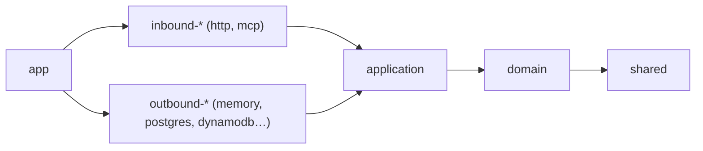

# 0004. Hexagon with one module per use case

- **Status:** Accepted
- **Date:** 2026-10-27
- **Ticket:** STU-24

Ports and adapters, split into crates. Inside the application crate, every use case is one module
with the same shape.

## Crates

Every crate may also depend on `shared`; those arrows are left out of the graph.

| Crate | Owns | May depend on (workspace) | May depend on (external) |
|---|---|---|---|
| `shared` | Generic utilities | nothing | `thiserror` |
| `domain` | Game rules and their types | `shared` | `thiserror` |
| `application` | Use cases and ports | `domain`, `shared` | `thiserror`, `serde`, `async-trait` |
| `inbound-<transport>` | Turning a request into a use-case call | `application`, `domain`, `shared` | any |
| `outbound-<technology>` | Implementing ports | `application`, `domain`, `shared` | any |
| `app` | Wiring and one binary per runtime target | all | any |

The table is a ceiling: a crate lists only the dependencies it uses, and a dependency is added by
the change that first uses it.

`shared`, `domain` and `application` are the core; every other crate is an adapter or wiring.
Each crate lives in `crates/<name>/`, and its package name is `<name>`. The in-memory adapter,
`outbound-memory`, is an adapter like any other. It is temporary: it runs the app until a database
adapter replaces it.

## Tests

Use-case tests never depend on an adapter, so they outlive any one of them and the core's
dependency lists stay exactly as the table says.

- **Test fakes** live in `application/src/testkit/<concern>.rs`, next to that port's shared test
  suite. Each fake runs its own port's suite. Fakes are not adapters.
- **Use-case tests** sit in the use case's file, in a `#[cfg(test)]` module, on the testkit fakes.
  A hand-written stub private to one test is fine for making a port fail on purpose.
- **Adapters** run the same suites. `testkit` is behind a `testkit` cargo feature that an
  `outbound-*` crate turns on only under `[dev-dependencies]`.

## Shared code

Code used in two or more modules has exactly one home. Classify it by asking these questions in
order and stop at the first "yes":

| # | Question | Kind | Home |
|---|---|---|---|
| 1 | Does it name a `domain` type, or encode a game rule (a limit, an order, who may do what)? | Shared game logic | `domain` |
| 2 | Is it a sequence of port calls that two or more use cases make? | Shared orchestration | One port method in `application/src/ports/<concern>.rs` |
| 3 | Does it use only `std`, `thiserror` and generic types? | Generic utility | `shared/src/<topic>.rs` |
| 4 | Anything else (for example, a helper two adapters share that needs `axum` or `sqlx`) | Not covered | Needs a new decision record before it's written |

A helper used in only one module stays private in that module and is none of the above.

## Rules

Each rule says what the reviewer checks and how a violation shows up. "Compiler" means the build
fails; "Review" means a person checks it by hand, until CI automates it (STU-34).

| # | Rule | Check | Violation shows up as |
|---|---|---|---|
| 1 | Workspace crates depend only as in the table above. | Compiler | Unresolved import of a crate that isn't a dependency. |
| 2 | `shared`, `domain` and `application` depend on nothing outside their row of the table. | Review | A diff in `crates/shared/Cargo.toml`, `crates/domain/Cargo.toml` or `crates/application/Cargo.toml` adding a crate the table doesn't list. |
| 3 | No adapter crate depends on another adapter crate. | Review | A diff in an `inbound-*` or `outbound-*` `Cargo.toml` naming another adapter. |
| 4 | Domain types never cross the wire. | Compiler | `domain` has no `serde`, so deriving `Serialize` on a domain type doesn't compile. |
| 5 | One use case = one file: `application/src/use_cases/<verb>_<noun>.rs`. | Review | A use case split across files, or two use cases in one file. |
| 6 | That file defines exactly `Input`, `Output`, `Error` and one public `run` function returning `Result<Output, Error>`. | Review | Any other public item in the file. |
| 7 | A use case never calls another use case; logic two use cases share goes in `domain`. | Review | `use crate::use_cases::` inside `application/src/use_cases/`. |
| 8 | Decisions about the game are made by `domain` functions. A use case loads through ports, calls the domain, saves through ports. | Review | A comparison (`==`, `!=`, `<`, `>`, `<=`, `>=`) or a count (`len`, `count`) in a use case on a value that came from a port or the domain. |
| 9 | `application` contains no numeric or duration literals other than `0` and `1`. Adapters keep every numeric or duration literal in a named `const`. | Review | Any other literal in `application`; an unnamed literal in an adapter. |
| 10 | Ports are traits in `application/src/ports/<concern>.rs`, one file per concern. Port signatures use only `domain` and `application` types. | Compiler (types) and Review (file layout) | A port in another place, or a port grouping unrelated concerns. |
| 11 | Every port has one shared test suite and one fake in `application/src/testkit/<concern>.rs`. The suite runs against that fake and every `outbound-*` implementation. | Review | A new port, fake or port implementation without the suite wired in. |
| 12 | `shared`, `domain` and `application` never read the clock or generate randomness or IDs; they ask a port. | Review | `SystemTime::now`, `Instant::now`, or a random or UUID call in those crates. |
| 13 | `Error` variants carry data (ids, counts), never sentences. Each inbound adapter maps every variant of a use case's `Error` in one exhaustive `match`, and that is the only place caller-facing wording is written. | Compiler (exhaustive `match`) and Review | An application error turned into text with `to_string()` or `format!` in an inbound crate; a `String` message field on an `Error` variant. |
| 14 | Inbound adapters call use cases only, never ports. | Review | `application::ports` imported in an `inbound-*` crate. |
| 15 | Each inbound crate exposes use cases in one file: `inbound-<transport>/src/bindings.rs`. Until STU-25 defines the mechanism, bindings there are written by hand. | Review | Use-case calls outside `bindings.rs`. |
| 16 | Outbound adapters only implement ports. Every `if` or `match` in them is about the technology: encoding, errors, retries, pagination. | Review | A branch in an `outbound-*` crate on a domain value for any other reason. |
| 17 | `app` only builds adapters and starts a runtime; one file per runtime in `app/src/bin/` (`lambda.rs`, `server.rs`). | Review | Any logic in `app` other than construction and startup. |
| 18 | Code used in two or more modules lives in the home the "Shared code" table gives it. | Review | The same function body in two places, or shared code in a home its classification doesn't give it. |
| 19 | `shared` can't see game types. | Compiler | `shared` has no workspace dependencies, so importing a `domain` or `application` type fails to resolve. |
| 20 | No module or file outside `shared` is named `util`, `utils`, `helper`, `helpers`, `common`, `misc` or `shared`. | Review | A file or `mod` with one of those names in any other crate. |
| 21 | `application/src/` contains only `lib.rs`, `ports/`, `use_cases/` and `testkit/`. | Review | Any other file or folder there, such as a helper module for use cases. |
| 22 | Names in `shared` use no game vocabulary (the concepts in `docs/domain/user-flow.md`). | Review | A type, function or module in `shared` named after a game concept. |
| 23 | The `testkit` feature is on only in tests: `application`'s own, and `outbound-*` crates' `[dev-dependencies]`. | Review | `features = ["testkit"]` under `[dependencies]` in any crate. |
| 24 | A use case acting for a player takes its `PlayerId` in `Input`, never a token or session. Each inbound adapter gets the `PlayerId` by calling its transport's authentication use case first (for MCP, `authenticate_agent_connection`). | Compiler (types) and Review | A token or session type in a use case's `Input` other than an authentication use case's. |
| 25 | A port that saves state a use case loaded refuses the save if that state changed since it was loaded, and its suite tests that refusal. | Review | A save method without a version check, or a suite without the conflict test. |

## Where a change goes

| Change | Where |
|---|---|
| New or changed game rule | `domain/src/<concept>.rs` |
| Logic two use cases share | `domain`, or one port method if it's only port calls (see "Shared code") |
| Generic helper used in two or more modules | `shared/src/<topic>.rs` |
| Helper two adapters share that needs an external crate | New decision record first |
| New use case | `application/src/use_cases/<verb>_<noun>.rs` |
| Expose a use case on a transport | One binding in `inbound-<transport>/src/bindings.rs` |
| New transport | New crate `inbound-<transport>`, wired in `app` |
| New outside need (storage, service, clock) | Port in `application/src/ports/<concern>.rs`, its fake and suite in `application/src/testkit/<concern>.rs`, and an implementation in each `outbound-*` crate that serves it |
| New storage or external provider | New crate `outbound-<technology>` passing the port suites, wired in `app` |
| New runtime target | `app/src/bin/<target>.rs` |

A change that fits none of these rows needs a new decision record before it's merged.
